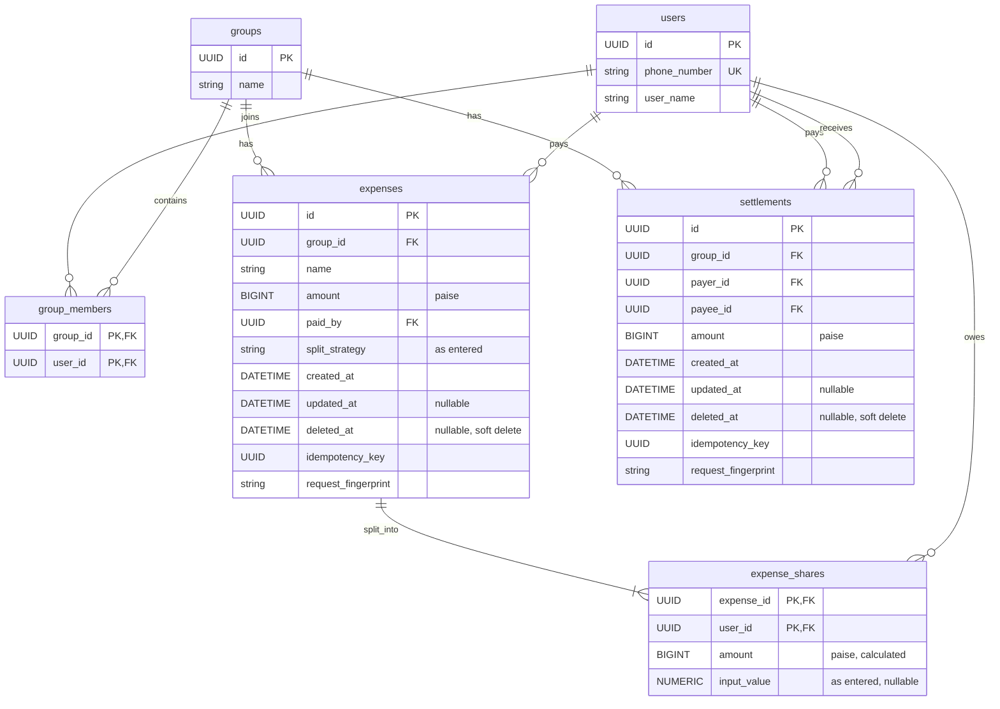

# SplitWise Backend: Design

A backend for splitting shared expenses within groups. Members record who paid for what and how it is split.
The service works out who owes whom, in each group and across all of a user's groups.

**Stack:** FastAPI, SQLAlchemy, PostgreSQL, run with docker-compose.

## 1. Scope

**In scope**
- Users, groups and group membership
- Expenses with one payer, split three ways:
  - **equal**: between all members, or between a chosen subset
  - **exact**: an amount per person
  - **percentage**: a percent per person
- Settlements: recording a payment from one member to another
- Balances:
  - each member's net balance in a group
  - pairwise balances between two members of a group
  - a user's balance in each group and the total across all groups
- Input validation and tests for the splitting and balance logic

**Stretch** (built only after the core, tests and README are done)
1. Editing and deleting expenses and settlements
2. Debt simplification: the fewest payments needed to settle a group

**Out of scope** (future work)
- Authentication and authorization: requests carry no caller identity. Fields like paid_by
  and payer_id describe the transaction, not who sent the request, so any client can act
  on any group and changes aren't attributed to anyone
- Frontend
- Expenses with more than one payer
- Multiple currencies
- Notifications

## 2. Data model

All amounts are BIGINT in paise (₹1 = 100 paise).

### ER diagram



### Tables, rules and decisions

```text
SCHEMA
All amounts are BIGINT in paise (₹1 = 100 paise, so ₹500 is stored as 50000).

users
  id              UUIDv7   PK
  phone_number    string   UNIQUE
  user_name       string

groups
  id              UUIDv7   PK
  name            string

group_members
  group_id        UUIDv7   FK -> groups.id
  user_id         UUIDv7   FK -> users.id
  PK (group_id, user_id)

expenses
  id              UUIDv7   PK
  group_id        UUIDv7   FK -> groups.id
  name            string
  amount          BIGINT   (paise)
  paid_by         UUIDv7   FK -> users.id
  split_strategy  string   equal | exact | percentage, as entered (decision 3)
  created_at      DATETIME
  updated_at      DATETIME NULL   (set on edit)
  deleted_at      DATETIME NULL   (soft delete: NULL = active)
  idempotency_key UUID           (client's Idempotency-Key, decision 10)
  request_fingerprint  string    (SHA-256 of the canonical request)
  UNIQUE (group_id, idempotency_key)

expense_shares
  expense_id      UUIDv7   FK -> expenses.id
  user_id         UUIDv7   FK -> users.id
  amount          BIGINT   (paise, calculated: what balances use)
  input_value     NUMERIC(15,2) NULL  (as entered: a percent or exact paise; NULL for equal)
  PK (expense_id, user_id)

settlements
  id              UUIDv7   PK
  group_id        UUIDv7   FK -> groups.id
  payer_id        UUIDv7   FK -> users.id
  payee_id        UUIDv7   FK -> users.id
  amount          BIGINT   (paise)
  created_at      DATETIME
  updated_at      DATETIME NULL   (set on edit)
  deleted_at      DATETIME NULL   (soft delete: NULL = active)
  idempotency_key UUID           (client's Idempotency-Key, decision 10)
  request_fingerprint  string    (SHA-256 of the canonical request)
  UNIQUE (group_id, idempotency_key)


RULES (enforced in application code)
  - For each expense, the expense_shares amounts must add up to expenses.amount.
  - Everyone involved in a group transaction must be a member of that group:
      expenses:    paid_by and every expense_shares.user_id
      settlements: payer_id and payee_id
  - Amounts must be positive and at most 10^12 paise (₹1000 crore), so oversized input is a
    422 and never overflows BIGINT. A settlement's payer and payee must be different users.


DECISIONS

1. Money is stored as integer paise, not as floats or rupees.
   Integer maths is exact, so there are no float rounding errors like 0.1 + 0.2 != 0.3.
   Amounts are converted to rupees only for display.

2. Balances are calculated, not stored.
   Expenses, shares and settlements are the single source of truth.
   A balance is calculated as: paid - shares + settlements paid - settlements received.
   Stored balances could drift out of sync, and editing or deleting an expense would mean
   rolling back balance updates by hand. The calculation is one SUM/GROUP BY query,
   which is fast at this scale with indexes on the FK columns.
   If reads ever get slow, a cache or materialized view can be added later.
   Each balance use case reads from a single REPEATABLE READ snapshot, so its several
   queries can't see a concurrent write halfway through (nets always sum to 0).

3. Every share is stored explicitly, including for equal splits, next to the split as entered.
   An equal split of ₹100 between 3 people becomes 3 expense_shares rows.
   The calculated amount is the source of truth: the balance logic never needs to know how
   an expense was split. The inputs are stored too (expenses.split_strategy and
   expense_shares.input_value), so a client can show the split again when the expense is
   edited: 33.33 / 33.33 / 33.34 % can't be recovered from 3333 / 3333 / 3334 paise.
   An equal split with no list stores who was in the group at that moment, so a member
   who joins later doesn't change an old expense.

4. The leftover paisa from an equal split goes to the payer.
   e.g. 10000 / 3 = 3333 each with 1 left over, so the payer's share is 3334.
   This rule is deterministic: the same input always gives the same split.
   If the payer isn't one of the people splitting, the leftover goes to the
   first participant, ordered by user id.

5. An equal split with no participants listed is split between all group members.
   Most real expenses are shared by the whole group, so this is the convenient default.
   To split between only some members, list their user ids explicitly.

6. Tables are created with Base.metadata.create_all on app startup, not with migrations.
   create_all only creates missing tables; it never alters existing ones, so a model change needs a fresh database (docker compose down -v).
   A production version would use Alembic migrations so the schema can evolve without data loss.

7. Code is split into three layers, each with one job:
     app/routers   HTTP only: parse the request, call one service function, shape the response.
                   Routers never touch the database or check business rules.
     app/services  One function per use case. Owns the database work and the business rules,
                   e.g. the group-membership rule lives once, in services/groups.py.
     app/domain    Pure calculations with no database (the split maths), unit-tested directly.
   Services raise domain errors (app/errors.py) that know nothing about HTTP; one exception
   handler in main.py maps them to status codes (NotFound 404, RuleViolation 422, Conflict 409).

8. Debt simplification is greedy and works only from net balances.
   Repeatedly, the biggest debtor pays the biggest creditor as much as they can
   (ties broken by user id, so the result is deterministic). Each payment settles at
   least one person, so n members need at most n - 1 payments. The true minimum is
   NP-hard (it means splitting members into subsets whose nets sum to 0), so greedy
   is the practical choice.
   Simplified payments can be between people who never shared an expense
   (A owes B, B owes C  ->  A pays C). Recording them as settlements brings every net
   to 0, but the pairwise amounts between those people stay non-zero: simplification
   settles nets, not pairwise debts.

9. Editing and deleting expenses and settlements.
   Deletes are soft: deleted_at is set and the row (and an expense's shares) stays, as an
   audit trail. Every query that reads expenses or sums their shares filters on ACTIVE_EXPENSE,
   and every query that reads settlements on ACTIVE_SETTLEMENT (deleted_at IS NULL), each
   defined once in models.py. A deleted row is a 404 everywhere.
   The one deliberate exception is the Idempotency-Key lookup (decision 10): a deleted row
   still owns its key, so a late retry must be able to find it.
   Edits are full replacements (PUT): the client sends the split again, pre-filled from the
   inputs a GET returns (decision 3). Because the inputs are stored, a PATCH that changes
   only the amount could recalculate the shares from them; it isn't built yet.
   The old shares are deleted and the new ones inserted in one transaction.
   Edits overwrite the old values; keeping every version would need a revisions table.
   Settlements are independent of expenses (people settle a running balance, not a bill),
   so they are never changed by an edit or delete. If an edit or delete removes a debt that
   was already settled, the balance flips sign: the overpayment is now owed back.
   Concurrent edits are last-write-wins. A production version would add a version column
   (optimistic locking) and return 409 when the expense changed since the client read it.
   Settlements follow the same rules. A settlement edit is a plain update (no shares), and
   deleting a settlement brings back the debt it paid.
   Edits and deletes lock the row first (SELECT ... FOR UPDATE), so concurrent writes to the
   same expense or settlement run one after another. Without the lock, two edits that change
   who is in a split could both insert the same expense_shares key and one would fail with a
   500; with it, a write that loses the race to a delete gets a 404. Writes stay on READ
   COMMITTED: that is what lets a waiting writer re-check deleted_at after the lock is released.
   PUT never creates (ids are generated by the server), so PUT to an unknown id is a 404.
   DELETE of an already-deleted row is a 404; the server state is unchanged either way.
   Lists are not paginated. A production version would use cursor pagination on
   (created_at, id), which is cheap because UUIDv7 ids are time-ordered.
   At larger scale, partial indexes on (group_id) WHERE deleted_at IS NULL help both tables.

10. POSTs that record money require an Idempotency-Key, so a retry never records it twice.
   The problem: the server commits, then the response is lost (timeout, dropped connection).
   The client can't tell "never arrived" from "saved, reply lost", so it must retry, and
   without a key the retry records the expense or settlement a second time.
   At-least-once delivery (the client retries) + idempotent processing (the server recognises
   the retry) = an exactly-once effect.

   Required, not optional. Public APIs (Stripe, PayPal) make the key optional because they
   serve third-party clients they don't control, many of which never retry, and their own
   SDKs add keys automatically. This is a first-party backend recording money, with no
   outside integrators and nothing to stay compatible with, so safe retries are part of
   the contract: a missing key is 400 (as the IETF Idempotency-Key draft specifies), so a
   client that forgets it fails at once in development instead of creating duplicates later.

   The client contract:
     - The key is a random UUID (uuid4: 122 random bits), generated ONCE, when the user starts
       the action (taps "Save"), outside the retry loop:
           key = uuid4()
           for attempt in range(5):
               try:   response = post(url, body, headers={"Idempotency-Key": key})
               except (Timeout, ConnectionError): backoff(); continue      # same key
               if response.status >= 500: backoff(); continue              # same key
               return response                                             # 2xx/4xx: final
     - Stored with the pending request (an outbox) if it must survive an app restart.
     - Never derived from the user or the request content: two genuine identical expenses
       (two ₹200 coffees) would collide and the second would be lost.

       event                                          key
       user taps Save                                 new uuid4()
       timeout / connection error / 5xx -> retry      the SAME key
       app restarts with the request still pending    the SAME key (from the outbox)
       user taps Save again, even with identical data new uuid4()

   What the server does (services/idempotency.py):
     - The key is stored on the row it creates, with a fingerprint of the request, under
       UNIQUE (group_id, idempotency_key). Both columns are NOT NULL.
     - No key: 400. Not a UUID: 422.
     - Key not seen before: normal create, 201.
     - Key seen before, same fingerprint: a retry. The stored row is returned (201) with the
       header Idempotent-Replayed: true, as it is NOW (edits since are included).
     - Key seen before, different fingerprint: 422. A client bug: the key was reused for a
       different request. Checked first, whatever the stored row's state.
     - Key seen before, row since deleted: 409. The request was already processed; a late
       retry must never bring back an expense someone deliberately deleted. Doing it again
       is a new action, so the client sends a new key.
     - A request that fails (e.g. 422) stores nothing, so a corrected retry with the same
       key goes through.
     - Simultaneous retries: both pass the lookup, both insert; Postgres makes the second
       wait on the unique index until the first commits, then raises a unique violation.
       The loser catches it (by constraint name) and returns the winner's row. Same
       insert-then-handle pattern as the duplicate phone check: no check-then-insert race,
       and never a half-finished state to report.

   What the server can't do: force a client to reuse its key on a retry. Requiring the
   header guarantees a key is sent, not that it's the right one: a client that generates a
   new key per retry still gets duplicates.

   Lifecycle example:
       tap Save -> K1;  POST(K1) commits, reply lost;  POST(K1) -> 201, replayed
       expense deleted;  a late POST(K1) arrives -> 409 (not recreated)
       tap Save again -> K2;  POST(K2) -> 201, a new expense

   The fingerprint is a check, not the key: a hash of the request would merge genuine
   duplicates. It is the SHA-256 of a canonical form of the validated request, so retries
   that rebuild the body slightly differently still match: names stripped, splits sorted by
   user, Decimal values normalised ("50" == "50.00"), strings and numbers alike.
   The key lives on the row, not in a separate table: it is written in the same transaction
   as the row, so the two can never disagree. A separate idempotency table storing whole
   responses (Stripe's approach) generalises to any endpoint, but needs expiry and cleanup;
   keys stored on the row never expire, at a cost of a few bytes per row.
   Keys are scoped to a group (the collection the POST writes to). PUT and DELETE need no
   key: repeating them leaves the same state.
```

## 3. API

```text
API DESIGN
All amounts are integers in paise, from 1 to 10^12 (₹1000 crore). All IDs are UUIDs.
POSTs that record money require an Idempotency-Key header (decision 10).
The HTTP status code carries success or failure; response bodies hold only data.
Errors return { "detail": "<reason>" }.
No auth: requests carry no caller identity. The users in a request (paid_by, payer_id,
payee_id, splits) say who the money involves, not who is making the request.


USERS

POST /users
  Create a user.
  request {
    phone_number   string
    user_name      string
  }
  response 201 {
    id, phone_number, user_name
  }
  errors
    409  phone_number already exists
    422  user_name or phone_number blank


GROUPS

POST /groups
  Create a group.
  request {
    name   string
  }
  response 201 {
    id, name
  }
  errors
    422  name blank

POST /groups/{group_id}/members
  Add users to a group.
  request {
    user_ids   [ user_id ]
  }
  response 200 {
    members   [ { user_id, user_name } ]   <- the full member list after adding, ordered by name
  }
  Idempotent: users already in the group are ignored, and an id listed twice
  is added once.
  errors
    404  group not found
    404  any user_id does not exist

GET /groups/{group_id}
  A group and its members.
  response 200 {
    id, name
    members   [ { user_id, user_name } ]
  }
  errors
    404  group not found


EXPENSES

POST /groups/{group_id}/expenses
  Create an expense in a group.
  header   Idempotency-Key: <uuid>   required; a retry with the same key returns the
           original expense (201, Idempotent-Replayed: true) instead of creating another
  request {
    name             string
    amount           int (paise)
    paid_by          user_id
    split_strategy   "equal" | "exact" | "percentage"
    splits           [ { user_id, value } ]
  }
    value means:
      equal        -> no value; just list the user_ids
      exact        -> amount this user owes, in paise
      percentage   -> percent this user owes
    If split_strategy is "equal" and splits is empty or omitted,
    the expense is split equally between all group members.
  response 201 {
    id, name, amount, paid_by, created_at
    updated_at                         <- null until the expense is edited
    split_strategy                     <- as entered
    splits   [ { user_id, value } ]    <- as entered, the request's shape (to pre-fill an edit)
    shares   [ { user_id, amount } ]   <- the calculated paise per person, ordered by user_id
  }
  errors
    404  group not found
    422  split_strategy is not one of the three
         paid_by is not a member of the group
         a user in splits is not a member of the group
         a user appears twice in splits
         amount, or any value, is zero or negative
         exact amounts don't add up to the total
         percentages don't add up to 100
         exact or percentage split with no splits listed (only equal has a default)
         amount (or an exact value) above 10^12
         Idempotency-Key is not a UUID, or was already used for a different request
    400  Idempotency-Key header missing
    409  Idempotency-Key was already used, and that expense has since been deleted

GET /groups/{group_id}/expenses
  List a group's expenses, newest first. Deleted expenses are not listed.
  response 200 {
    expenses   [ same shape as the POST response, shares included ]
  }
  errors
    404  group not found

GET /groups/{group_id}/expenses/{expense_id}
  One expense.
  response 200   same shape as POST
  errors
    404  group not found
    404  expense not found, deleted, or in a different group

PUT /groups/{group_id}/expenses/{expense_id}
  Replace an expense: same request as POST (see decision 9 for why not PATCH).
  Deletes the old shares and recalculates them in one DB transaction; sets updated_at.
  Concurrent edits: last write wins.
  response 200   same shape as POST
  errors
    404  group not found
    404  expense not found, already deleted, or in a different group
    422  same as POST; the expense is left unchanged

DELETE /groups/{group_id}/expenses/{expense_id}
  Soft-delete an expense: it disappears from expenses, balances and simplified debts.
  Settlements are not changed (decision 9).
  response 204   (no body)
  errors
    404  group not found
    404  expense not found, already deleted, or in a different group


SETTLEMENTS

POST /groups/{group_id}/settlements
  Record a payment from one member to another.
  header   Idempotency-Key: <uuid>   required; same behaviour as for expenses
  request {
    payer_id   user_id
    payee_id   user_id
    amount     int (paise)
  }
  response 201 {
    id, payer_id, payee_id, amount, created_at
    updated_at   <- null until the settlement is edited
  }
  errors
    404  group not found
    422  payer or payee is not a member of the group
         payer and payee are the same user
         amount is zero or negative, or above 10^12
         Idempotency-Key is not a UUID, or was already used for a different request
    400  Idempotency-Key header missing
    409  Idempotency-Key was already used, and that settlement has since been deleted
  A settlement may be larger than what is owed; the balance simply flips sign.

GET /groups/{group_id}/settlements
  List a group's settlements, newest first. Deleted settlements are not listed.
  response 200 {
    settlements   [ same shape as the POST response ]
  }
  errors
    404  group not found

GET /groups/{group_id}/settlements/{settlement_id}
  One settlement.
  response 200   same shape as POST
  errors
    404  group not found
    404  settlement not found, deleted, or in a different group

PUT /groups/{group_id}/settlements/{settlement_id}
  Replace a settlement: same request as POST; sets updated_at. Last write wins.
  response 200   same shape as POST
  errors
    404  group not found
    404  settlement not found, already deleted, or in a different group
    422  same as POST; the settlement is left unchanged

DELETE /groups/{group_id}/settlements/{settlement_id}
  Soft-delete a settlement: balances no longer count it, so the debt it paid comes back.
  response 204   (no body)
  errors
    404  group not found
    404  settlement not found, already deleted, or in a different group


BALANCES

GET /groups/{group_id}/balances
  Each member's net balance in the group.
  Positive = is owed money, negative = owes money. All nets sum to 0.
  response 200 {
    balances   [ { user_id, user_name, net } ]
  }
  errors
    404  group not found

GET /groups/{group_id}/balances/{user_id}
  What one user owes, or is owed by, each other member of the group (pairwise).
  response 200 {
    user_id
    net
    balances   [ { user_id, user_name, amount } ]   <- positive = they owe you
  }
  errors
    404  group or user not found
    422  user is not a member of the group
  Pairwise amounts include settlements between the two users.

GET /users/{user_id}/balances
  A user's net balance in each of their groups, plus the total across all groups.
  response 200 {
    user_id
    total_net
    groups   [ { group_id, group_name, net } ]
  }
  errors
    404  user not found

GET /groups/{group_id}/simplified-debts               [STRETCH]
  Debt simplification: the payments that would settle everyone in the group.
  Calculated from net balances (greedy: biggest debtor pays biggest creditor;
  see decision 8). At most (members - 1) payments, biggest first.
  Nothing is stored; recording a payment is still a POST to /settlements.
  response 200 {
    payments   [ { from_user_id, to_user_id, amount } ]   <- empty when everyone is settled
  }
  errors
    404  group not found
```

## 4. Tests

```text
docker compose run --rm --build test                          # everything (~1 min)
docker compose run --rm --build test pytest tests/unit -v     # any pytest arguments
```

The `test` service runs pytest against a separate database, `<POSTGRES_DB>_test`, on the same
Postgres server. It is created on first use and its schema is rebuilt at the start of every
run. Every table is emptied before each test, and the suite refuses to run against a database
whose name does not end in `_test`. Tests use real Postgres, not SQLite, because much of what
they check is Postgres behaviour: ON CONFLICT, constraint names, snapshots and row locks.
Any warning fails the run (pytest.ini).

```text
tests/unit/                        Pure logic, no database
  test_splits.py                   Every split rule; property tests (Hypothesis) against an
                                   independent integer-only calculation
  test_simplify.py                 Debt simplification; property tests: settles everyone,
                                   at most n-1 payments, biggest first, deterministic
tests/integration/                 Real Postgres, through the API unless noted
  test_users_and_groups.py         Validation boundaries, 409 duplicate phone, idempotent members
  test_expenses.py                 Each split strategy; one case per kind of 422, each checked to save nothing
  test_expense_edits.py            PUT/DELETE, soft delete, interaction with settlements
  test_settlements.py              Create, list, get, edit, delete
  test_balances.py                 The worked example by hand; ordering; every error case
  test_simplified_debts.py         The endpoint and its wiring to balances
  test_database_constraints.py     CHECK/UNIQUE/PK/FK rules written directly, bypassing the API
  test_snapshot.py                 Forces a write between two balance queries; the result must be
                                   the state before it. A control test proves the write lands.
  test_idempotency.py              Idempotency-Key: replays, equivalent bodies, 422/409 cases
  test_concurrency.py              Parallel threads, one connection each: row locks on edit/delete,
                                   idempotent member adds, one winner for a duplicate phone,
                                   simultaneous retries with one Idempotency-Key
  test_invariants.py               Seeded random operations across two groups; after every step the
                                   API is compared with a model and an independent balance oracle
```

The concurrency, snapshot, ordering and idempotency tests were each checked by removing the
code they protect (the row lock, the snapshot, the share ordering, the idempotency UNIQUE
constraint) and confirming that they fail.
