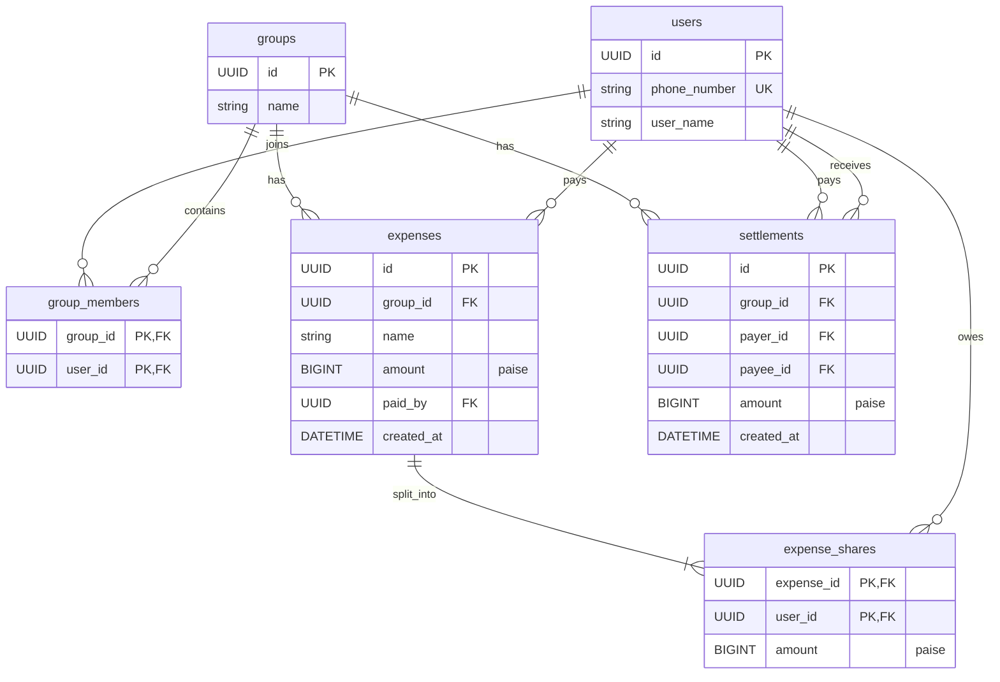

# SplitWise Backend: Design

A backend for splitting shared expenses within groups. Members record who paid for what and how it is split.
The service works out who owes whom, in each group and across all of a user's groups.

**Stack:** FastAPI, SQLAlchemy, PostgreSQL, run with docker-compose.

## 1. Scope

**In scope**
- Users, groups and group membership
- Expenses with one payer, split three ways:
  - **equal**: between all members, or between a chosen subset
  - **exact**: an amount per person
  - **percentage**: a percent per person
- Settlements: recording a payment from one member to another
- Balances:
  - each member's net balance in a group
  - pairwise balances between two members of a group
  - a user's balance in each group and the total across all groups
- Input validation and tests for the splitting and balance logic

**Stretch** (built only after the core, tests and README are done)
1. Editing and deleting expenses
2. Debt simplification: the fewest payments needed to settle a group

**Out of scope** (future work)
- Authentication: the acting user is passed explicitly in requests
- Frontend
- Expenses with more than one payer
- Multiple currencies
- Notifications

## 2. Data model

All amounts are BIGINT in paise (₹1 = 100 paise).

### ER diagram



### Tables, rules and decisions

```text
SCHEMA
All amounts are BIGINT in paise (₹1 = 100 paise, so ₹500 is stored as 50000).

users
  id              UUIDv7   PK
  phone_number    string   UNIQUE
  user_name       string

groups
  id              UUIDv7   PK
  name            string

group_members
  group_id        UUIDv7   FK -> groups.id
  user_id         UUIDv7   FK -> users.id
  PK (group_id, user_id)

expenses
  id              UUIDv7   PK
  group_id        UUIDv7   FK -> groups.id
  name            string
  amount          BIGINT   (paise)
  paid_by         UUIDv7   FK -> users.id
  created_at      DATETIME

expense_shares
  expense_id      UUIDv7   FK -> expenses.id
  user_id         UUIDv7   FK -> users.id
  amount          BIGINT   (paise)
  PK (expense_id, user_id)

settlements
  id              UUIDv7   PK
  group_id        UUIDv7   FK -> groups.id
  payer_id        UUIDv7   FK -> users.id
  payee_id        UUIDv7   FK -> users.id
  amount          BIGINT   (paise)
  created_at      DATETIME


RULES (enforced in application code)
  - For each expense, the expense_shares amounts must add up to expenses.amount.
  - Everyone involved in a group transaction must be a member of that group:
      expenses:    paid_by and every expense_shares.user_id
      settlements: payer_id and payee_id
  - Amounts must be positive. A settlement's payer and payee must be different users.


DECISIONS

1. Money is stored as integer paise, not as floats or rupees.
   Integer maths is exact, so there are no float rounding errors like 0.1 + 0.2 != 0.3.
   Amounts are converted to rupees only for display.

2. Balances are calculated, not stored.
   Expenses, shares and settlements are the single source of truth.
   A balance is calculated as: paid - shares + settlements paid - settlements received.
   Stored balances could drift out of sync, and editing or deleting an expense would mean
   rolling back balance updates by hand. The calculation is one SUM/GROUP BY query,
   which is fast at this scale with indexes on the FK columns.
   If reads ever get slow, a cache or materialized view can be added later.

3. Every share is stored explicitly, including for equal splits.
   An equal split of ₹100 between 3 people becomes 3 expense_shares rows.
   The balance logic never needs to know how an expense was split.

4. The leftover paisa from an equal split goes to the payer.
   e.g. 10000 / 3 = 3333 each with 1 left over, so the payer's share is 3334.
   This rule is deterministic: the same input always gives the same split.
   If the payer isn't one of the people splitting, the leftover goes to the
   first participant, ordered by user id.

5. An equal split with no participants listed is split between all group members.
   Most real expenses are shared by the whole group, so this is the convenient default.
   To split between only some members, list their user ids explicitly.
```

## 3. API

```text
API DESIGN
All amounts are integers in paise. All IDs are UUIDs.
The HTTP status code carries success or failure; response bodies hold only data.
Errors return { "detail": "<reason>" }.
No auth: the acting user is passed explicitly (in the path or the request body).


USERS

POST /users
  Create a user.
  request {
    phone_number   string
    user_name      string
  }
  response 201 {
    id, phone_number, user_name
  }
  errors
    409  phone_number already exists
    422  user_name or phone_number blank


GROUPS

POST /groups
  Create a group.
  request {
    name   string
  }
  response 201 {
    id, name
  }
  errors
    422  name blank

POST /groups/{group_id}/members
  Add users to a group.
  request {
    user_ids   [ user_id ]
  }
  response 200 {
    members   [ { user_id, user_name } ]   <- the full member list after adding
  }
  Idempotent: users already in the group are ignored, and an id listed twice
  is added once.
  errors
    404  group not found
    404  any user_id does not exist

GET /groups/{group_id}
  A group and its members.
  response 200 {
    id, name
    members   [ { user_id, user_name } ]
  }
  errors
    404  group not found


EXPENSES

POST /groups/{group_id}/expenses
  Create an expense in a group.
  request {
    name             string
    amount           int (paise)
    paid_by          user_id
    split_strategy   "equal" | "exact" | "percentage"
    splits           [ { user_id, value } ]
  }
    value means:
      equal        -> no value; just list the user_ids
      exact        -> amount this user owes, in paise
      percentage   -> percent this user owes
    If split_strategy is "equal" and splits is empty or omitted,
    the expense is split equally between all group members.
  response 201 {
    id, name, amount, paid_by, created_at
    shares   [ { user_id, amount } ]   <- the calculated paise per person
  }
  errors
    404  group not found
    422  split_strategy is not one of the three
         paid_by is not a member of the group
         a user in splits is not a member of the group
         a user appears twice in splits
         amount, or any value, is zero or negative
         exact amounts don't add up to the total
         percentages don't add up to 100
         exact or percentage split with no splits listed (only equal has a default)

GET /groups/{group_id}/expenses
  List a group's expenses, newest first.
  response 200 {
    expenses   [ same shape as the POST response, shares included ]
  }
  errors
    404  group not found

PUT /groups/{group_id}/expenses/{expense_id}          [STRETCH]
  Replace an expense: same request as POST.
  Deletes the old shares and recomputes them in one DB transaction.
  response 200   same shape as POST
  errors   404 expense not found, 422 same as POST

DELETE /groups/{group_id}/expenses/{expense_id}       [STRETCH]
  Delete an expense and its shares.
  response 204   (no body)
  errors   404 expense not found


SETTLEMENTS

POST /groups/{group_id}/settlements
  Record a payment from one member to another.
  request {
    payer_id   user_id
    payee_id   user_id
    amount     int (paise)
  }
  response 201 {
    id, payer_id, payee_id, amount, created_at
  }
  errors
    404  group not found
    422  payer or payee is not a member of the group
         payer and payee are the same user
         amount is zero or negative
  A settlement may be larger than what is owed; the balance simply flips sign.


BALANCES

GET /groups/{group_id}/balances
  Each member's net balance in the group.
  Positive = is owed money, negative = owes money. All nets sum to 0.
  response 200 {
    balances   [ { user_id, user_name, net } ]
  }
  errors
    404  group not found

GET /groups/{group_id}/balances/{user_id}
  What one user owes, or is owed by, each other member of the group (pairwise).
  response 200 {
    user_id
    net
    with   [ { user_id, user_name, amount } ]   <- positive = they owe you
  }
  errors
    404  group or user not found
    422  user is not a member of the group
  Pairwise amounts include settlements between the two users.

GET /users/{user_id}/balances
  A user's net balance in each of their groups, plus the total across all groups.
  response 200 {
    user_id
    total_net
    groups   [ { group_id, group_name, net } ]
  }
  errors
    404  user not found

GET /groups/{group_id}/simplified-debts               [STRETCH]
  Debt simplification: the payments that would settle everyone in the group.
  Calculated from net balances (greedy: biggest debtor pays biggest creditor).
  Nothing is stored; recording a payment is still a POST to /settlements.
  response 200 {
    payments   [ { from_user_id, to_user_id, amount } ]
  }
  errors
    404  group not found
```
