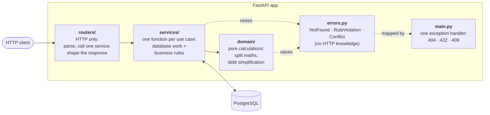
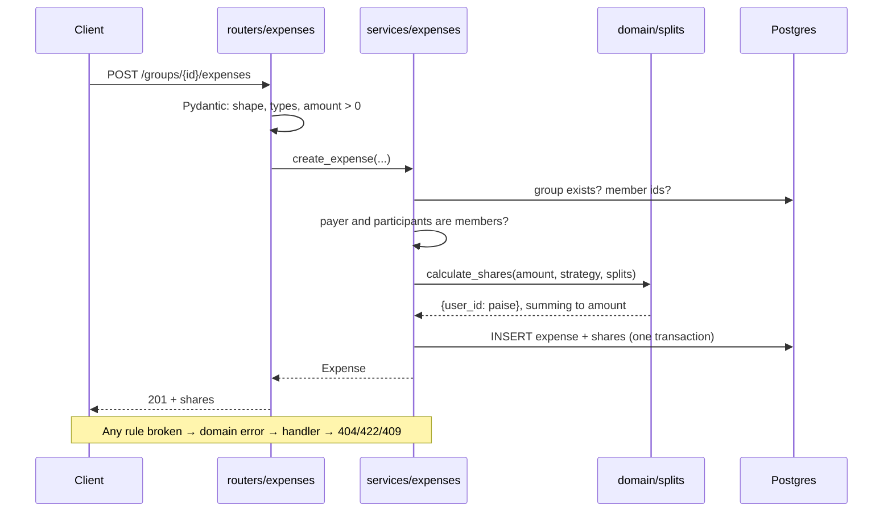
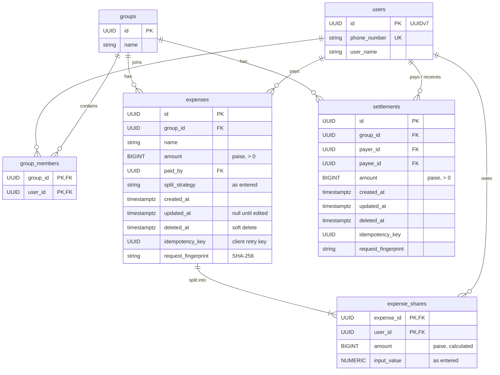
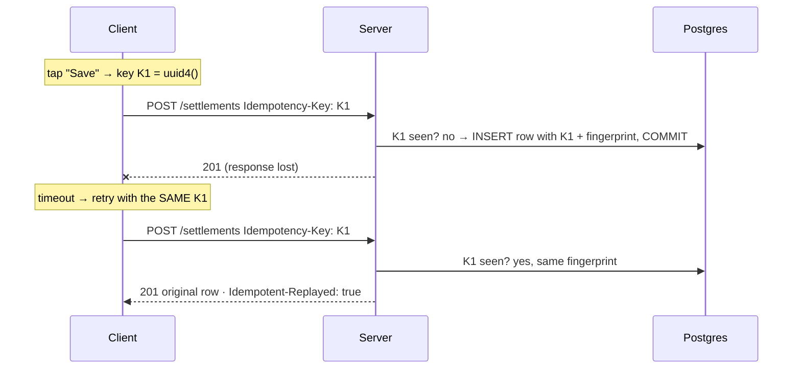

# SplitWise Backend

A REST API for splitting shared expenses within groups: record who paid for what, split it equally, by exact amounts or by percentage, and see who owes whom, in each group and across all of a user's groups.

**FastAPI · SQLAlchemy 2 · PostgreSQL 16 · Docker Compose · pytest + Hypothesis (162 tests)**

| Requirement | Where it's met |
|---|---|
| Create transactions, split equally or unequally | `POST /groups/{id}/expenses`: `equal`, `exact` or `percentage` |
| See what each person owes | `GET /groups/{id}/balances`: every member's net balance |
| See what a user is owed in each group | `GET /groups/{id}/balances/{user_id}`: who owes this user, and whom this user owes |
| See the total across all groups | `GET /users/{id}/balances`: net per group, plus `total_net` |
| *Beyond the brief* | Settlements, editing and deleting, debt simplification, safe retries (idempotency keys) |

---

## Contents

- [SplitWise Backend](#splitwise-backend)
  - [Contents](#contents)
  - [1. Quick start](#1-quick-start)
  - [2. A two-minute tour](#2-a-two-minute-tour)
  - [3. Architecture](#3-architecture)
    - [Three layers, each with one job](#three-layers-each-with-one-job)
    - [One request, end to end](#one-request-end-to-end)
    - [Project layout](#project-layout)
  - [4. Data model](#4-data-model)
    - [Rules enforced by the database](#rules-enforced-by-the-database)
    - [Rules enforced by the application](#rules-enforced-by-the-application)
    - [Choices in the schema](#choices-in-the-schema)
  - [5. How splitting works](#5-how-splitting-works)
  - [6. How balances work](#6-how-balances-work)
    - [Calculated, not stored](#calculated-not-stored)
    - [One consistent snapshot per read](#one-consistent-snapshot-per-read)
  - [7. Debt simplification](#7-debt-simplification)
  - [8. Editing and deleting](#8-editing-and-deleting)
  - [9. Concurrency and consistency](#9-concurrency-and-consistency)
    - [Safe retries: idempotency keys](#safe-retries-idempotency-keys)
  - [10. Decisions and trade-offs](#10-decisions-and-trade-offs)
  - [11. API reference](#11-api-reference)
  - [12. Testing](#12-testing)
  - [13. Limitations and production roadmap](#13-limitations-and-production-roadmap)

---

## 1. Quick start

**Requires:** Docker with Docker Compose.

```bash
cp .env.example .env               # database credentials (never committed)
docker compose up --build          # Postgres + the API on http://localhost:8000
```

| | |
|---|---|
| Interactive API docs (Swagger) | http://localhost:8000/docs |
| Health check | http://localhost:8000/health |
| Run the test suite | `docker compose run --rm --build test` |
| Reset the database | `docker compose down -v` |

Tables are created on startup. The tests run against a separate `<POSTGRES_DB>_test` database on the same server, so they never touch development data.

---

## 2. A two-minute tour

All amounts are integers in **paise** (₹1 = 100 paise). Three friends share a trip:

```http
POST /users          {"phone_number": "+919800000001", "user_name": "Kush"}       → 201 {"id": "<kush>", ...}
POST /users          {"phone_number": "+919800000002", "user_name": "Shivanshu"}  → 201
POST /users          {"phone_number": "+919800000003", "user_name": "Ansh"}       → 201
POST /groups         {"name": "Goa Trip"}                                         → 201 {"id": "<trip>", ...}
POST /groups/<trip>/members   {"user_ids": ["<kush>", "<shivanshu>", "<ansh>"]}   → 200
```

Shivanshu pays ₹1000 for dinner. No participants are listed, so it is split equally between everyone:

```http
POST /groups/<trip>/expenses
{"name": "Dinner", "amount": 100000, "paid_by": "<shivanshu>", "split_strategy": "equal"}

→ 201
{
  "id": "…", "name": "Dinner", "amount": 100000, "paid_by": "<shivanshu>",
  "created_at": "2026-11-19T12:23:33Z", "updated_at": null,
  "split_strategy": "equal",
  "splits": [{"user_id": "<kush>", "value": null}, …],   ← as entered: pre-fills an edit form
  "shares": [
    {"user_id": "<kush>",      "amount": 33333},
    {"user_id": "<shivanshu>", "amount": 33334},   ← the leftover paisa goes to the payer
    {"user_id": "<ansh>",      "amount": 33333}
  ]
}
```

Add a cab (₹600, Kush pays, split between Kush and Ansh), a hotel (₹5000, Ansh pays, exact amounts) and snacks (₹100, Kush pays, 33.33/33.33/33.34 %). Then Kush pays Shivanshu back ₹300:

```http
POST /groups/<trip>/settlements   {"payer_id": "<kush>", "payee_id": "<shivanshu>", "amount": 30000}
```

**Retries are safe.** If Kush's phone loses the response, it resends the same request with the same `Idempotency-Key`, and gets the original settlement back instead of paying twice ([§9](#safe-retries-idempotency-keys)):

```http
POST /groups/<trip>/settlements   Idempotency-Key: 6f1c2a9e-…   {…same body…}   → 201 {"id": "<s1>", …}
POST /groups/<trip>/settlements   Idempotency-Key: 6f1c2a9e-…   {…same body…}   → 201 {"id": "<s1>", …}
                                                                                   Idempotent-Replayed: true
```

**What does each person owe?** Positive means they are owed money, negative means they owe money, and the nets always sum to 0:

```http
GET /groups/<trip>/balances
→ {"balances": [
     {"user_name": "Ansh",      "net":  283333},
     {"user_name": "Kush",      "net": -166666},
     {"user_name": "Shivanshu", "net": -116667}
   ]}
```

**Whom does Kush owe?** Positive means they owe Kush:

```http
GET /groups/<trip>/balances/<kush>
→ {"net": -166666, "balances": [
     {"user_name": "Ansh",      "amount": -166666},   ← Kush owes Ansh ₹1666.66
     {"user_name": "Shivanshu", "amount": 0}          ← settled
   ]}
```

**Across all of Kush's groups:** `GET /users/<kush>/balances` returns `{"total_net": -166666, "groups": [...]}`.

**The fewest payments that settle the group:**

```http
GET /groups/<trip>/simplified-debts
→ {"payments": [
     {"from_user_id": "<kush>",      "to_user_id": "<ansh>", "amount": 166666},
     {"from_user_id": "<shivanshu>", "to_user_id": "<ansh>", "amount": 116667}
   ]}
```

Every number above is checked by a test (`tests/integration/test_balances.py::test_worked_example_*`).

---

## 3. Architecture

### Three layers, each with one job



| Layer | Knows about | Never does | Tested by |
|---|---|---|---|
| `routers/` | HTTP, Pydantic schemas | touch the database, check business rules | API tests |
| `services/` | SQLAlchemy, transactions, the membership rule | build HTTP responses | API, concurrency and snapshot tests |
| `domain/` | integers and `Decimal` | I/O of any kind | unit and property tests, in milliseconds |

**Why it matters:**
- **The split maths is pure.** It can be unit-tested with thousands of generated inputs, without a database.
- **Each business rule lives in exactly one place.** For example, "everyone in a transaction must be a group member" is one function in `services/groups.py`, used by expenses and settlements.
- **Errors carry meaning, not status codes.** A service raises `RuleViolationError`; `main.py` decides that means 422. Changing the error format is a one-line change.

### One request, end to end



### Project layout

```text
app/
  main.py              App, lifespan (create tables), domain-error → HTTP mapping, /health
  database.py          Engine, session-per-request dependency, use_snapshot()
  models.py            SQLAlchemy models, constraint naming convention, ACTIVE_* filters
  schemas.py           Pydantic request/response models (request shape only)
  errors.py            DomainError → NotFoundError / RuleViolationError / ConflictError
  idempotency.py       Idempotency-Key header + request fingerprint (HTTP side)
  routers/             users, groups, expenses, settlements, balances
  services/            one module per resource; balances.py holds all balance queries;
                       idempotency.py holds the shared replay logic
  domain/
    splits.py          equal / exact / percentage → per-person paise
    simplify.py        net balances → fewest payments (greedy)
tests/
  unit/                pure logic + Hypothesis property tests
  integration/         real Postgres: API, constraints, snapshots, concurrency, invariants
DESIGN.md              full design doc: every request/response body and error case
```

---

## 4. Data model



**There is no balances table.** Balances are always calculated from `expenses`, `expense_shares` and `settlements`, which are the single source of truth ([§6](#6-how-balances-work)).

### Rules enforced by the database

These hold even if application code has a bug, and each one has a test that writes the invalid row directly.

| Rule | Constraint |
|---|---|
| Money is positive | `ck_expenses_amount_positive`, `ck_expense_shares_amount_positive`, `ck_settlements_amount_positive` |
| The split as entered is valid | `ck_expenses_split_strategy_valid` (one of the three strategies), `ck_expense_shares_input_value_positive` |
| You can't pay yourself | `ck_settlements_payer_not_payee` |
| One account per phone number | `uq_users_phone_number` |
| A user is in a group once | `pk_group_members (group_id, user_id)` |
| One share per person per expense | `pk_expense_shares (expense_id, user_id)` |
| References exist | foreign keys on every `*_id` column |
| Shares never outlive their expense | `expense_shares.expense_id … ON DELETE CASCADE` |
| A retry key creates at most one row per group | `uq_expenses_group_id_idempotency_key`, `uq_settlements_group_id_idempotency_key` |
| Every expense and settlement has a retry key | `idempotency_key` and `request_fingerprint` are `NOT NULL` |

Constraint names come from a **naming convention** (`models.py`), so they are predictable. Two features depend on this: the duplicate-phone check (409) and concurrent idempotent retries both identify the violated constraint by name. Every column, type, constraint and index is listed in [DESIGN.md §2](DESIGN.md#tables-rules-and-decisions).

### Rules enforced by the application

They need more than one row, so a CHECK constraint can't express them:
- An expense's shares add up to its amount (asserted in `domain/splits.py`).
- Everyone involved in a group transaction is a member of the group: the payer, every participant, and both people in a settlement.

### Choices in the schema

| Choice | Why |
|---|---|
| **Integer paise in `BIGINT`** | Floats can't represent money exactly (`0.1 + 0.2 ≠ 0.3`). `BIGINT` holds up to ₹92 quadrillion; `INT` would stop at about ₹2.1 crore. The API caps each amount at 10¹² paise (₹1000 crore), so oversized input is a 422, never an overflow. |
| **UUIDv7 primary keys** | Not guessable or enumerable like 1, 2, 3, and safe to generate anywhere. Unlike UUIDv4 they are **time-ordered**, so B-tree inserts stay sequential and `ORDER BY created_at, id` is a stable tie-break. |
| **Composite primary keys on join tables** | `(group_id, user_id)` *is* the identity of a membership. A surrogate id would need a separate UNIQUE constraint to say the same thing. |
| **Every share stored, even for equal splits, next to the split as entered** | Balance queries only read the calculated `amount`: a share is a share. The inputs (`split_strategy`, `input_value`) are kept so an edit form can show the split again; 33.33 % can't be recovered from 3333 paise. |
| **Indexes on every foreign key** | Postgres doesn't index foreign keys automatically. The balance queries filter and group on exactly these columns. `group_members.user_id` has its own index because the composite primary key only helps lookups that start with `group_id`. |
| **`timestamptz`** | Stored in UTC, with no ambiguity across time zones. |

---

## 5. How splitting works

`domain/splits.py` turns a request into exact per-person paise. **The shares always add up to the amount, to the paisa.**

| Strategy | `splits` | Example: ₹1000 (`100000`) paid by B |
|---|---|---|
| `equal` | omitted means every member; otherwise a list of user ids | A 33333 · **B 33334** · C 33333 |
| `exact` | an amount in paise for each person | A 20000 · B 50000 · C 30000 (must total 100000) |
| `percentage` | a percent for each person, up to 2 decimals, totalling exactly 100 | 33.33 / 33.33 / 33.34 → 33330 / 33330 / 33340 |

**The rounding rule:** when an amount doesn't divide evenly, every share is **rounded down**, and the leftover paise go to **one** person:
1. **The payer, if they are splitting.** Fronting the bill and absorbing at most a few paise is the natural fairness rule.
2. Otherwise, **the participant with the lowest user id**.

Rounding down means the leftover is never negative and is always less than 1 paisa per person. The rule is deterministic: the same request always gives the same shares, whatever order the participants are listed in.

`Decimal` is used for percentages, never `float`.

**Rejected with 422 and a clear message:**
- percentages that don't total 100
- exact amounts that don't add up to the total, or that include fractions of a paisa
- a person listed twice
- values on an equal split, or a missing value on an exact or percentage split
- an amount too small to give everyone at least 1 paisa
- an amount above 10¹² paise (₹1000 crore)

---

## 6. How balances work

**Sign convention everywhere:** positive means *is owed*, negative means *owes*.

```text
net = (what you paid for expenses) − (your shares) + (settlements you paid) − (settlements you received)
```

| Endpoint | What it calculates | Invariant |
|---|---|---|
| `GET /groups/{id}/balances` | each member's net in the group | the nets sum to **0**: money can't be created or lost in a group |
| `GET /groups/{id}/balances/{user}` | what each other member owes this user (each share is a debt between the participant and that expense's payer) | the amounts add up to the user's net; A's view of B = −(B's view of A) |
| `GET /users/{id}/balances` | the user's net in each group, plus `total_net` | `total_net` = the sum of the group nets |

### Calculated, not stored

| | Calculated on read (chosen) | Stored running balances |
|---|---|---|
| Correctness | Always right: there is nothing to drift out of sync | Every write path must update balances perfectly, forever |
| Edits and deletes | Free: the next read reflects them | Need a matching reversal for every change |
| Read cost | A fixed number of `SUM … GROUP BY` queries (4 for a group, 5 for a user across *all* their groups), on indexed columns | One row lookup |
| Write cost | One insert | Insert plus balance updates, with lock contention on hot rows |

At this scale, correctness wins. If reads ever became the bottleneck, a cache or materialized view could be added **in front of** the source of truth without changing the model.

The query count doesn't grow with the number of groups. A user's totals across 50 groups are still 5 queries, not 4 × 50 + 1. This avoids the N+1 query problem.

### One consistent snapshot per read

A balance is several queries. Under Postgres' default isolation level (READ COMMITTED), each query sees the database at a slightly different moment. An expense committed *between* the "paid" query and the "shares" query would be half-counted, and the nets would no longer sum to 0.

Each balance use case therefore runs under **REPEATABLE READ** (`database.use_snapshot`): all its queries see one snapshot. A test forces exactly that interleaving. Without the snapshot it fails, and the debt-simplification endpoint even crashes, because its input nets no longer sum to 0.

---

## 7. Debt simplification

`GET /groups/{id}/simplified-debts` answers: **what is the smallest set of payments that settles everyone?**

```text
Before (debts as recorded)            After simplification
  Kush ──₹100──▶ Shivanshu              Kush ──₹100──▶ Ansh
  Shivanshu ──₹100──▶ Ansh              (Shivanshu is already even)
```

**The algorithm** (`domain/simplify.py`) works only from net balances:
1. Split the members into debtors (net < 0) and creditors (net > 0).
2. The **biggest debtor pays the biggest creditor** as much as they can.
3. Whoever reaches 0 drops out, and the rest repeat.

Two heaps make it O(n log n). Ties are broken by user id, so the output is deterministic.

| Property | Why it holds | Tested by |
|---|---|---|
| Settles every net exactly | each payment moves money from a debtor to a creditor | property test |
| At most n − 1 payments | each payment brings at least one person to 0 | property test |
| Payments come biggest first | the largest remaining debt and credit only ever shrink | property test |
| Deterministic | user-id tie-break | property test |

**Trade-off:** the *true* minimum number of payments is **NP-hard**. It means splitting people into the most subsets whose nets sum to 0. Greedy is the standard practical answer, and its n − 1 bound is tight in the worst case.

**Nothing is stored.** The suggestions are recalculated on every request, because stored suggestions would be stale after the next expense. People record what they actually pay as settlements.

---

## 8. Editing and deleting

| | Behaviour | Why |
|---|---|---|
| **Delete** | Soft delete: `deleted_at` is set, and the row (and an expense's shares) stays | Audit trail, and undo is possible. Every query filters through one shared expression (`ACTIVE_EXPENSE` / `ACTIVE_SETTLEMENT`), defined once in `models.py`. |
| **Edit** | `PUT`, a full replacement; the shares are recalculated from scratch in one transaction | A GET returns the split as entered, in the request's shape, so the client pre-fills the form and sends it back. Since the inputs are stored, a `PATCH` of just the amount is possible later. |
| **Settlements after an expense changes** | Never modified | People settle a *running balance*, not a specific bill. If a settled expense is deleted, the balance flips sign: the overpayment is now owed back. That's correct, and it's how real expense apps behave. |
| **Deleted rows** | 404 for GET, PUT and DELETE; excluded from every list and balance | To the API, a deleted row doesn't exist. |
| **PUT to an unknown id** | 404 | Ids are generated by the server; PUT never creates. |

---

## 9. Concurrency and consistency

Every race below has a test that runs the operations in **parallel threads, each with its own database connection**, released together by a barrier.

| Race | What would go wrong | Protection |
|---|---|---|
| Two edits of the same expense | Both replace the shares; the second inserts a duplicate `(expense_id, user_id)` and the request fails with a **500** | `SELECT … FOR UPDATE` on the expense row: writers queue, and last write wins |
| An edit racing a delete | The edit applies to an expense that was just deleted | The same lock. Under READ COMMITTED, the waiting writer re-checks `deleted_at IS NULL` and gets a clean **404** |
| Two signups with the same phone number | Check-then-insert lets both through | Insert first and let `UNIQUE` decide: exactly one 201, the rest 409 |
| Adding the same member twice concurrently | A duplicate-key error | `INSERT … ON CONFLICT DO NOTHING` |
| An expense added mid-way through a balance read | A half-counted expense, so the nets don't sum to 0 | REPEATABLE READ snapshot ([§6](#6-how-balances-work)) |
| A client retries a POST whose response was lost | The money is recorded twice | `Idempotency-Key` ([below](#safe-retries-idempotency-keys)) |
| Two copies of that retry arrive at once | Both pass the "seen this key?" check | `UNIQUE (group_id, idempotency_key)`: the second waits, fails, and returns the first one's row |

> **Found by testing, not by inspection.** The first edit endpoint had no row lock. A stress test of 10 parallel edits that changed *who was in the split* returned **500 on 180 of 200 requests** (a `UniqueViolation`). Edits that kept the same people passed, which is why simpler tests missed it. With the lock: 200 of 200 succeed. The test is kept, and removing the lock makes it fail.

**Deadlock-free by design:** every writer locks the expense row *before* touching its shares, so locks are always taken in the same order. **Writes stay on READ COMMITTED on purpose:** under REPEATABLE READ, a writer that loses the race gets a serialization error (a 500) instead of a clean 404.

### Safe retries: idempotency keys

The server commits, then the response is lost. The client can't tell "never arrived" from "saved, reply lost", so it has to retry, and a plain retry records the money twice. **At-least-once delivery + idempotent processing = an exactly-once effect.**



| The key is… | Response |
|---|---|
| missing | 400: required on every POST that records money |
| never seen before | create it: 201 |
| seen, with the same request | **replay**: the stored row (as it is now), 201, `Idempotent-Replayed: true` |
| seen, with a *different* request | 422: the key was reused for something else (a client bug) |
| seen, but that row was since deleted | 409: already processed; a late retry never brings back a deliberate delete |

- **Required, not optional.** Public APIs such as Stripe make the key optional because they serve third-party clients they don't control. This is a first-party backend recording money, so safe retries are part of the contract, and a client that forgets the key fails immediately instead of creating duplicates later.
- **The client generates the key:** a random UUID per user action, reused only by that action's retries. It's never derived from the user or the content, because two genuine ₹200 coffees must stay two expenses.
- **The fingerprint is a check, not the key.** It's a SHA-256 of a *canonical* form of the request (splits sorted, `"50"` = `"50.00"`, names trimmed), so a retry that rebuilds the body slightly differently still matches.
- **The key lives on the row**, written in the same transaction, so the row and its key can never disagree. Stripe-style separate tables generalise to any endpoint but need expiry and cleanup.
- **PUT and DELETE need no key:** repeating them leaves the same state.

Full client contract and edge cases: [DESIGN.md decision 10](DESIGN.md#tables-rules-and-decisions).

---

## 10. Decisions and trade-offs

| Decision | Alternative considered | Why this one | What it costs |
|---|---|---|---|
| **PostgreSQL** | MongoDB or another document store | The data is relational (users ↔ groups ↔ expenses ↔ shares), balances are aggregations, and correctness depends on transactions and constraints | — |
| **Integer paise** | `float` / `NUMERIC` rupees | Exact arithmetic; integer `SUM`s are fast | Convert to rupees for display |
| **Balances calculated on read** | Stored running balances | Can't drift; edits and deletes are free | A few `SUM`s per read (§6) |
| **REPEATABLE READ for balance reads** | Default READ COMMITTED | Consistent multi-query reads | Slightly more snapshot bookkeeping in Postgres |
| **Leftover paisa to the payer** | Spread it out; or to the first listed | Deterministic and intuitive | One person may carry up to n − 1 extra paise |
| **Equal split with no list = whole group** | Always require a list | Matches the common case | A client must list ids to split between a subset |
| **Soft delete** | Hard delete | Audit trail, undo | Every query must filter (enforced by one shared expression + tests) |
| **Store the split as entered, edit with PUT** | Store only the calculated shares | The edit screen can show the original split (percentages can't be recovered from paise) | Two extra columns; PATCH is possible but not built yet |
| **Idempotency key required, stored on the row** | Optional key; or a separate idempotency table storing whole responses | First-party backend recording money, so safe retries are part of the contract. Same transaction as the row, so they can't disagree; no expiry or cleanup job | Every client must send a key; keys never expire |
| **Last write wins on concurrent edits** | Optimistic locking (`ETag` / `If-Match` → 412); or PATCH | No client yet to resolve conflicts; PATCH would only protect edits to *different* fields | A lost update is possible (documented) |
| **Greedy debt simplification** | An exact minimum | Exact is NP-hard; greedy is ≤ n − 1 and O(n log n) | Occasionally one more payment than optimal |
| **`create_all` on startup** | Alembic migrations | Fewer moving parts for a project with no deployed data | A model change needs `docker compose down -v` |
| **No auth: requests carry no caller identity** | JWT or sessions | The brief is the splitting logic | Any client can read or change any group, and changes aren't attributed to anyone (see §13) |
| **Sync endpoints** | `async` + asyncpg | SQLAlchemy sync is simpler and runs in FastAPI's thread pool; the load is I/O-light | Fewer concurrent requests per worker than async |
| **Tests on real Postgres** | SQLite in memory | The behaviour under test *is* Postgres: `ON CONFLICT`, row locks, snapshots, constraint names | Tests need Docker (about a minute) |
| **Containers run as a non-root user** | The image default (root) | Least privilege: a compromised process can't rewrite the code (owned by root) or act as root | — |

---

## 11. API reference

Full request and response bodies, and every error case, are in **[DESIGN.md §3](DESIGN.md#3-api)**. Interactive docs are at `/docs`.

| Method | Path | Success | Errors |
|---|---|---|---|
| `GET` | `/health` | 200 | 503 if the database is down |
| `POST` | `/users` | 201 | 409 duplicate phone · 422 |
| `POST` | `/groups` | 201 | 422 |
| `GET` | `/groups/{group_id}` | 200 (with members) | 404 |
| `POST` | `/groups/{group_id}/members` | 200 (full member list; idempotent) | 404 group or user · 422 |
| `POST` | `/groups/{group_id}/expenses` | 201 (with calculated shares; a retry with the same `Idempotency-Key` replays it) | 400 no key · 404 · 409 key's expense was deleted · 422 |
| `GET` | `/groups/{group_id}/expenses` | 200 (newest first) | 404 |
| `GET` | `/groups/{group_id}/expenses/{expense_id}` | 200 | 404 |
| `PUT` | `/groups/{group_id}/expenses/{expense_id}` | 200 | 404 · 422 (expense unchanged) |
| `DELETE` | `/groups/{group_id}/expenses/{expense_id}` | 204 | 404 |
| `POST` | `/groups/{group_id}/settlements` | 201 (replayed on retry, as above) | 400 no key · 404 · 409 key's settlement was deleted · 422 |
| `GET` | `/groups/{group_id}/settlements` | 200 (newest first) | 404 |
| `GET` | `/groups/{group_id}/settlements/{settlement_id}` | 200 | 404 |
| `PUT` | `/groups/{group_id}/settlements/{settlement_id}` | 200 | 404 · 422 |
| `DELETE` | `/groups/{group_id}/settlements/{settlement_id}` | 204 | 404 |
| `GET` | `/groups/{group_id}/balances` | 200 | 404 |
| `GET` | `/groups/{group_id}/balances/{user_id}` | 200 | 404 · 422 not a member |
| `GET` | `/users/{user_id}/balances` | 200 | 404 |
| `GET` | `/groups/{group_id}/simplified-debts` | 200 | 404 |

**Error conventions:**
- The status code carries success or failure.
- Business-rule errors return `{"detail": "<readable reason>"}`.
- Request-shape errors (from Pydantic) return `{"detail": [{"loc": [...], "msg": "..."}]}`.
- **404** means the thing doesn't exist. **422** means it exists but the request breaks a rule, e.g. the user isn't a member of this group.
- Amounts are integers in paise from 1 to 10¹². POSTs that record money **require** an `Idempotency-Key: <uuid>` header (400 if missing).

---

## 12. Testing

```bash
docker compose run --rm --build test                        # all 162 tests, ~1 min
docker compose run --rm --build test pytest tests/unit -v   # any pytest arguments
```

| Layer | Tests | Approach |
|---|---|---|
| **Unit**: split maths, debt simplification | 35 | One example per rule, plus **Hypothesis property tests**: thousands of generated inputs compared against an independent integer-only calculation |
| **API**: every endpoint | 82 | Happy paths, the worked example by hand, and one case per kind of error (each rejected request is also checked to have **saved nothing**) |
| **Idempotency keys** | 13 | Missing key is 400, replays, equivalent bodies (reordered splits, `"50"` vs `"50.00"`), the 409/422 cases, scoping, failed requests not remembered |
| **Database constraints** | 14 | Invalid rows written directly, bypassing the API; asserts the constraint *name* |
| **Snapshot isolation** | 6 | Forces a write between two balance queries; the result must be the state before it. A control test proves the write really lands. |
| **Concurrency** | 8 | Real parallel connections: racing edits, edit vs delete, double deletes, duplicate signups, member adds, simultaneous retries with one key |
| **Randomised invariants** | 4 seeds × 80 operations | Random expenses, edits, deletes, settlements and late retries across two overlapping groups; **after every step**, compared with a model and an independent balance oracle |

**Making sure the tests can fail.** Each critical protection was removed in a throwaway container to confirm its tests catch it:

| Protection removed | Tests that fail |
|---|---|
| Row lock (`FOR UPDATE`) | 2 concurrency tests |
| Snapshot (`use_snapshot`) | 2 snapshot tests |
| Ordering of shares | 4 tests, including the randomised invariants |
| The idempotency `UNIQUE` constraint | 3 tests (2 concurrency, 1 constraint) |
| The amount cap | 4 tests |
| The soft-delete filter on *one* pairwise query | every randomised invariant seed |

**Bugs the tests found:**
1. **Concurrent edits returning 500s.** Fixed with the row lock (§9).
2. **Non-deterministic order of `shares` in responses.** Without an `ORDER BY`, Postgres returns rows in storage order, which changes after an edit. It's now ordered by `user_id`.
3. **A deprecated test client dependency.** Caught because warnings are treated as errors (`pytest.ini`).
4. **The test image couldn't write its caches once it ran as non-root.** Also caught by warnings-as-errors: Docker's `WORKDIR` creates `/code` as root.

**Found in code review, now covered by tests:** an amount of 2⁶³ paise overflowed `BIGINT` and returned a 500. It's now capped at 10¹² (a 422).

---

## 13. Limitations and production roadmap

What is deliberately out of scope, and what a production version would add:

| Area | Now | Production |
|---|---|---|
| **Auth** | None: requests carry no caller identity. `paid_by` and `payer_id` describe the transaction, not who sent it. | JWT or OAuth identifies the caller; only group members can read or write a group; `created_by` / `updated_by` record *who* made each change |
| **Schema changes** | `create_all` on startup | **Alembic** migrations, run as a deploy step |
| **Concurrent edits** | Last write wins (writes are serialized, so nothing is corrupted) | Optimistic locking: a version exposed as an `ETag`; edits send `If-Match`, 412 if stale, 428 if missing |
| **Edit history and undo** | Edits overwrite; deletes are soft | An append-only `audit_log` (entity, action, `actor_id`, `before` / `after` JSONB snapshots incl. shares, timestamp), written **in the same transaction** as each create, update and delete. It powers an activity feed and undo, where undo is itself a new logged operation, never a rewrite of the log. Undo can be limited to a 30-day window, but the log itself is kept long-term (money disputes need it), with monthly partitions so old data can be archived cheaply. Needs auth first, so `actor_id` can record *who*. |
| **Lists** | Not paginated | Cursor pagination on `(created_at, id)`, cheap because ids are UUIDv7 |
| **Read performance** | Calculated on every request | Partial indexes `WHERE deleted_at IS NULL`; a cached or materialized balance view if reads dominate |
| **Money** | One currency (INR) | A currency column per group or expense; conversion at a recorded rate |
| **Expenses** | One payer | Multiple payers: a `payments` table mirroring `expense_shares` |
| **Groups** | Members can't leave | Leaving or removal, allowed only at a zero balance |
| **Operations** | `/health`, logging of database failures, containers run as non-root | Structured logs with request ids, metrics, tracing, rate limiting, CI running the test suite on every PR, a pinned and scanned base image |

---

<sub>Design details: [DESIGN.md](DESIGN.md) · Python 3.11 · FastAPI 0.164 · SQLAlchemy 2.1 · psycopg 3.3 · PostgreSQL 16</sub>
